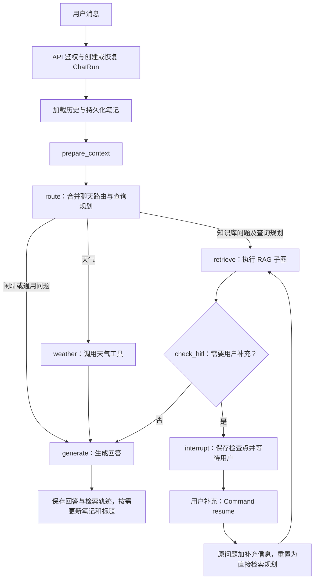
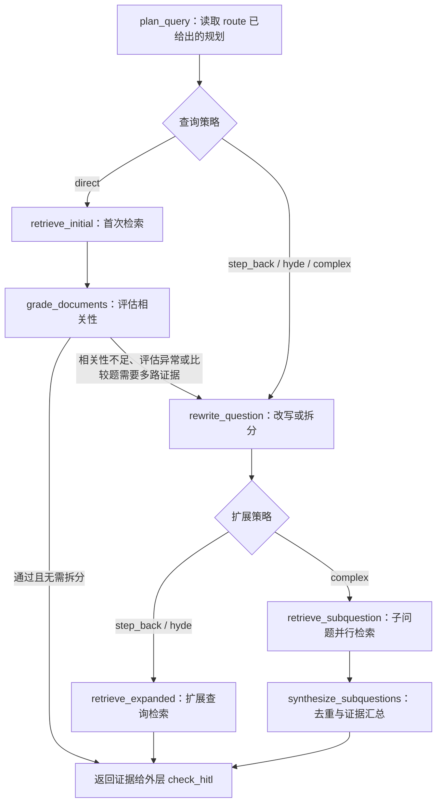

# ChatCat 项目说明

[![zread](https://img.shields.io/badge/Ask_Zread-_.svg?style=flat&color=00b0aa&labelColor=000000&logo=data%3Aimage%2Fsvg%2Bxml%3Bbase64%2CPHN2ZyB3aWR0aD0iMTYiIGhlaWdodD0iMTYiIHZpZXdCb3g9IjAgMCAxNiAxNiIgZmlsbD0ibm9uZSIgeG1sbnM9Imh0dHA6Ly93d3cudzMub3JnLzIwMDAvc3ZnIj4KPHBhdGggZD0iTTQuOTYxNTYgMS42MDAxSDIuMjQxNTZDMS44ODgxIDEuNjAwMSAxLjYwMTU2IDEuODg2NjQgMS42MDE1NiAyLjI0MDFWNC45NjAxQzEuNjAxNTYgNS4zMTM1NiAxLjg4ODEgNS42MDAxIDIuMjQxNTYgNS42MDAxSDQuOTYxNTZDNS4zMTUwMiA1LjYwMDEgNS42MDE1NiA1LjMxMzU2IDUuNjAxNTYgNC45NjAxVjIuMjQwMUM1LjYwMTU2IDEuODg2NjQgNS4zMTUwMiAxLjYwMDEgNC45NjE1NiAxLjYwMDFaIiBmaWxsPSIjZmZmIi8%2BCjxwYXRoIGQ9Ik00Ljk2MTU2IDEwLjM5OTlIMi4yNDE1NkMxLjg4ODEgMTAuMzk5OSAxLjYwMTU2IDEwLjY4NjQgMS42MDE1NiAxMS4wMzk5VjEzLjc1OTlDMS42MDE1NiAxNC4xMTM0IDEuODg4MSAxNC4zOTk5IDIuMjQxNTYgMTQuMzk5OUg0Ljk2MTU2QzUuMzE1MDIgMTQuMzk5OSA1LjYwMTU2IDE0LjExMzQgNS42MDE1NiAxMy43NTk5VjExLjAzOTlDNS42MDE1NiAxMC42ODY0IDUuMzE1MDIgMTAuMzk5OSA0Ljk2MTU2IDEwLjM5OTlaIiBmaWxsPSIjZmZmIi8%2BCjxwYXRoIGQ9Ik0xMy43NTg0IDEuNjAwMUgxMS4wMzg0QzEwLjY4NSAxLjYwMDEgMTAuMzk4NCAxLjg4NjY0IDEwLjM5ODQgMi4yNDAxVjQuOTYwMUMxMC4zOTg0IDUuMzEzNTYgMTAuNjg1IDUuNjAwMSAxMS4wMzg0IDUuNjAwMUgxMy43NTg0QzE0LjExMTkgNS42MDAxIDE0LjM5ODQgNS4zMTM1NiAxNC4zOTg0IDQuOTYwMVYyLjI0MDFDMTQuMzk4NCAxLjg4NjY0IDE0LjExMTkgMS42MDAxIDEzLjc1ODQgMS42MDAxWiIgZmlsbD0iI2ZmZiIvPgo8cGF0aCBkPSJNNCAxMkwxMiA0TDQgMTJaIiBmaWxsPSIjZmZmIi8%2BCjxwYXRoIGQ9Ik00IDEyTDEyIDQiIHN0cm9rZT0iI2ZmZiIgc3Ryb2tlLXdpZHRoPSIxLjUiIHN0cm9rZS1saW5lY2FwPSJyb3VuZCIvPgo8L3N2Zz4K&logoColor=ffffff)](https://zread.ai/humbleor/ChatCat)

ChatCat 是一个基于 LangGraph StateGraph 的 RAG 聊天机器人，后端 FastAPI + 前端 Vue3 / TypeScript / Vite。核心能力：混合检索（Milvus 稠密向量 + 服务端 BM25 稀疏向量）、Jina / TEI 重排序、三级滑动窗口分块 + 自动合并、检索前查询规划、人工澄清与恢复（HITL）、SSE 流式输出 + 实时 RAG 步骤可视化、JWT 鉴权 + RBAC 权限（admin/user）、PostgreSQL 持久化、Redis 缓存。

## Agent 一次请求的完整流程

入口是 `backend/api/api.py` 的 `/chat` 或 `/chat/stream`。API 鉴权后创建或恢复一个持久化 `ChatRun`，以 `request_id` 处理重复请求。`backend/agent/agent.py` 加载会话历史和持久化笔记，按需压缩历史，再把输入交给 `backend/rag/chat_graph.py` 的统一对话图。



图节点在执行过程中通过 custom 事件输出回答内容和检索步骤；在 `/chat/stream` 路径中，API 将其转换为 SSE，前端逐步显示。正常结束后保存回答与 `rag_trace` 并完成本次 Run；HITL 挂起时保存追问，Run 状态为 `waiting_hitl`。

### 聊天路由和查询策略只判断一次

`route` 在**同一次模型调用**中返回 `mode`（`retrieve` / `generate` / `weather`）、`strategy`、可选的上下文消歧查询 `query`、选择理由及天气城市。明确的“城市 + 天气”句式可以走正则快速路径，省去这次模型调用。

| 查询策略 | 适用情况 | 后续动作 |
| --- | --- | --- |
| `direct` | 普通、具体、含义明确的问题；同一篇论文或对象的多个方面 | 直接用问题检索，再评估文档相关性 |
| `step_back` | 过度依赖具体细节，需要通用原理帮助检索 | 先生成退步问题和背景扩展，再检索 |
| `hyde` | 目标可以判断的模糊或概念性问题 | 先生成假设性文档，仅用于检索 |
| `complex` | 多个不同实体或主题需要分别寻找证据 | 拆分子问题，最多 3 路并行检索，再去重汇总 |

明确的上下文指代可在这次路由中改写成独立问题；缺少无法推断的关键信息时，不靠改写补造条件，交给后续 HITL 判断。路由模型不可用或输出异常时，按直接检索兜底。

### RAG 子图：按规划检索，必要时补救

`backend/rag/rag_pipeline.py` 返回文档、上下文和检索轨迹，最终回答由外层对话图的 `generate` 节点生成。



聊天链路已把规划传入 RAG，因此 `plan_query` 只读取并应用结果，**不会再调用一次查询规划模型**。只有独立调用 `run_rag_graph()` 且没有传入 `query_plan` 时，子图才自行调用规划模型。

检索前已选定改写策略的请求，会先改写再检索，跳过原问题的首次检索；直接检索仍保留评分失败后的补救路径。扩展检索或并行汇总结束后直接返回外层，不再循环评分与改写。因此，“路由与规划合为一次调用”不代表整轮聊天只调用一次模型，也不保证所有问题只检索一次；评分、查询扩展、子问题拆分、HITL 判断和最终回答仍可能调用模型，复杂题也可能执行多路检索。

### 澄清、恢复和取消

`check_hitl` 在检索后判断是否需要澄清歧义或选择知识范围，最多追问 3 轮。没有检索到文档时记录 `no_knowledge`，进入回答阶段说明缺少可靠知识，不挂起等待用户。

需要追问时，LangGraph 的 `interrupt()` 将状态通过 PostgresSaver 保存到 PostgreSQL。用户携带 `resume_run_id` 补充信息后，通过同一 Run 的 `Command(resume=...)` 恢复：把原问题和历次补充合并，清掉旧的消歧查询，直接重新检索，随后再次进入 `check_hitl`；这条恢复路径不重新经过 `route`。

检查点线程按 `{user_id}:{session_id}:{run_id}` 隔离。`GET /chat/runs/{run_id}` 可查询状态，`POST /chat/runs/{run_id}/cancel` 取消指定 Run；取消等待中的 HITL 时会同时删除它的检查点。

检索轨迹中的 `query_plan`、`query_plan_reason` 和 `query` 记录本次子图的查询策略、理由及规划后的问题（可能已经消歧）；扩展检索文本另见 `expanded_query` / `hypothetical_doc`，子问题见 `sub_questions`。`retrieval_calls` 记录该次子图内的检索调用数，包括补救和子问题检索；每次 HITL 恢复重新进入子图后重新计数。

## 本地部署

### 1) 环境准备
- Python `3.12+`
- 包管理建议：`uv`（也支持 `pip`）
- Docker / Docker Compose（用于启动业务依赖）

### 2) 使用 pyproject 安装依赖
在项目根目录执行：

```bash
# 方式 A：推荐（uv）
uv sync
```

```bash
# 方式 B：pip
python -m venv .venv
source .venv/bin/activate
pip install -U pip
pip install -e .
```

### 3) 创建 `.env` 文件
在项目根目录新建 `.env`，可直接使用下面模板，填上你的内容：

```bash
cp .env.example .env
```

### 4) Docker 部署（数据库 + 缓存 + 向量库 + Reranker）

当前仓库的 `docker-compose.yml` 同时承载业务依赖、Milvus 依赖和可选的 TEI Reranker：
- 业务依赖：`postgres`、`redis`
- 向量依赖：`etcd`、`minio`、`standalone`、`attu`
- 重排序服务：`reranker`（位于 `reranker` profile，默认不启动）

```bash
# 启动数据库、缓存和向量库
docker compose up -d

# 启动 CPU Reranker（适合兼容性验证）
docker compose --profile reranker up -d reranker

# 或启动 GPU Reranker（RTX 4000 系列等 Ada GPU）
docker compose -f docker-compose.yml -f docker-compose.reranker-gpu.yml --profile reranker up -d reranker

# 查看状态和日志
docker compose ps
docker compose logs -f standalone
docker logs -f chatcat-reranker

# 停止依赖服务
docker compose down
docker compose -f docker-compose.yml -f docker-compose.reranker-gpu.yml --profile reranker down
```

其他 GPU 架构可通过 `TEI_RERANKER_GPU_IMAGE` 选择对应的 TEI 镜像。使用本机 TEI 时，在 `.env` 中配置：

```dotenv
RERANK_PROVIDER=tei
RERANK_MODEL=BAAI/bge-reranker-v2-m3
RERANK_BINDING_HOST=http://127.0.0.1:8081
RERANK_API_KEY=
RERANK_TIMEOUT_SECONDS=30
```

模型首次启动时会下载到 `volumes/huggingface/`，后续重建或重启容器会复用该缓存；但每次启动仍需将模型加载到内存或显存。不要删除该目录，否则需要重新下载模型。如果模型下载失败，应优先检查 Hugging Face 网络或镜像源，避免配置不完整的 `HF_ENDPOINT`。

启动后确认 Reranker 已就绪：

```bash
curl --noproxy '*' http://127.0.0.1:8081/health
curl --noproxy '*' http://127.0.0.1:8081/info
docker inspect --format '{{.State.Health.Status}}' chatcat-reranker
```

健康状态应为 `healthy`。如果 ChatCat 后端也运行在同一个 Compose 网络中，将 `RERANK_BINDING_HOST` 改为 `http://reranker:80`。修改 Reranker 环境变量后需要重启后端，因为 Provider 配置在进程启动时加载。Reranker 不改变 `bge-m3` 的 1024 维向量，因此切换 `jina`/`tei` 无需重建 Milvus；服务不可用时会保留原始 RRF 顺序，并在 `rag_trace.rerank_error` 中记录错误。

端口说明：
- PostgreSQL：`5432`
- Redis：`6379`
- Milvus：`19530`
- Milvus 健康检查：`9091`
- MinIO API：`9000`
- MinIO Console：`9001`
- Attu：`8080`
- Reranker：`8081`

### 5) 启动应用并访问
在 Milvus 启动后，运行后端应用：

```bash
# Backend
uv run uvicorn backend.core.app:app --host 0.0.0.0 --port 8000 --reload

# Frontend (proxies to backend:8000)
cd frontend
npm run dev  # Vite on :3000
npm run build
```

浏览器访问：
- 前端页面：`http://127.0.0.1:8000/`
- API 文档：`http://127.0.0.1:8000/docs`


## 代码格式化 / Lint

```bash
# 后端
uv run ruff format backend tests
uv run ruff check --fix backend tests

# 前端
cd frontend && npm run format && npm run lint:fix
```
